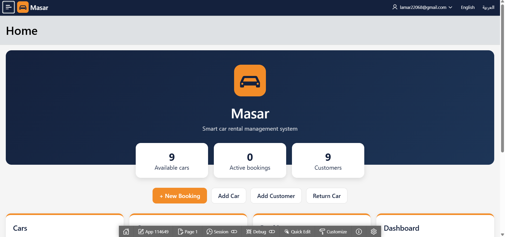
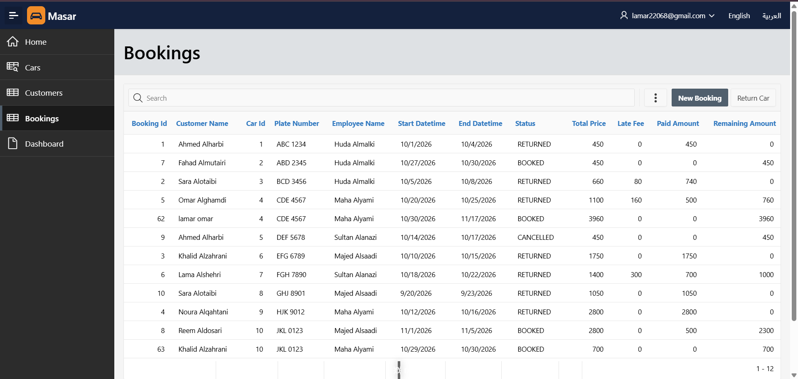
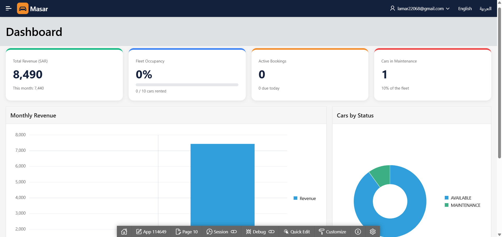
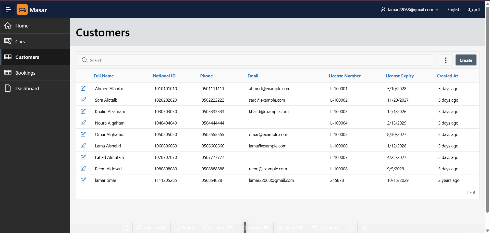
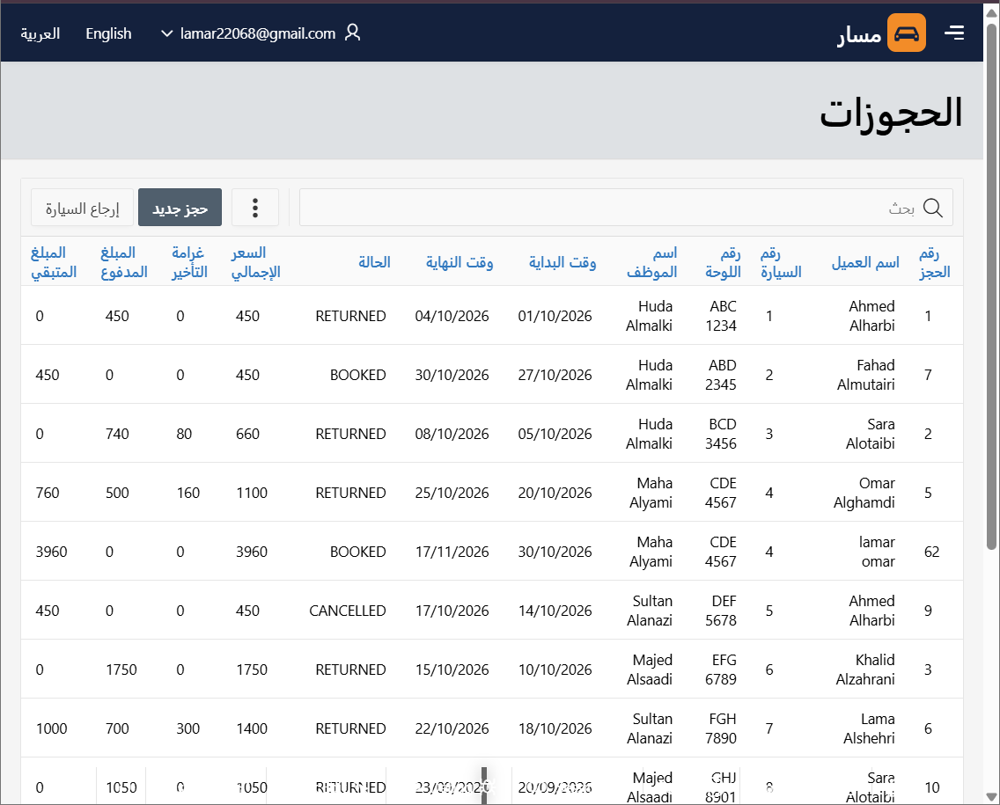
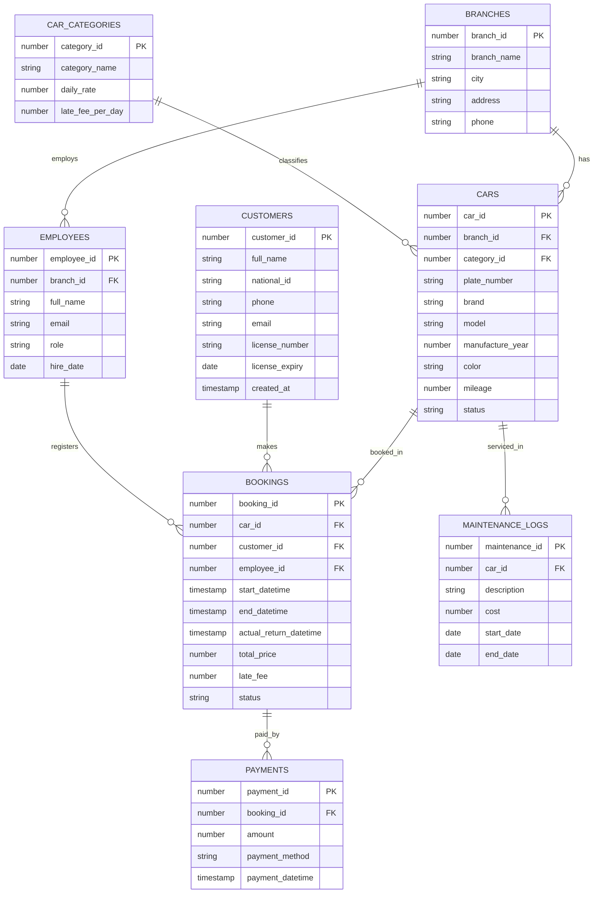

# Masar

A car rental management system I built with Oracle Database, PL/SQL and Oracle APEX. It's a portfolio project, so I tried to build it the way a small rental office would actually need it.

## What it does

- Manage cars, customers and bookings
- The price is calculated automatically when you pick a car and the dates
- You can't book the same car twice for overlapping dates
- Returning a car calculates the late fee and makes the car available again
- Dashboard with revenue and fleet stats, visible to managers only
- Three roles: Administrator, Contributor and Reader
- English and Arabic, the whole page flips to right-to-left when you switch

## Screenshots

**Bookings**

**Dashboard**

**Customers**

**Arabic version**

## Database

8 tables: branches, car categories, cars, customers, employees, bookings, payments and maintenance logs.

ERD (click to open)

The logic that lives in the database:

- `CALC_PRICE` (function): daily rate of the car category times the number of days
- `RETURN_CAR` (procedure): saves the return, works out the late fee, closes the booking and frees the car
- `TRG_CHECK_CAR_OVERLAP` (trigger): rejects overlapping bookings for the same car. It's a compound trigger because a normal row-level trigger that reads the same table gives ORA-04091
- `BOOKING_DETAILS` (view): bookings joined with customer, car, employee and how much was paid

## Run it yourself

1. Make a free workspace on [apex.oracle.com](https://apex.oracle.com)
2. Go to SQL Workshop > SQL Scripts and run the files in `sql/` in this order: `01_create_tables`, `02_sample_data`, `03_view`, `04_functions_procedures`, `05_triggers`
3. Import the app from the `apex/` folder (App Builder > Import)
4. In Application Access Control, give your user the Administrator role

`00_drop_all.sql` wipes everything, `06_practice_queries.sql` has some example queries and `07_tests.sql` has the tests I used for the price function, the trigger and the return procedure.

## About me

I'm Lamar.

- GitHub: [lamar22068-spec](https://github.com/lamar22068-spec)
- LinkedIn: [Lamar Alhawasawi](https://www.linkedin.com/in/lamar-alhawasawi-681641315)
